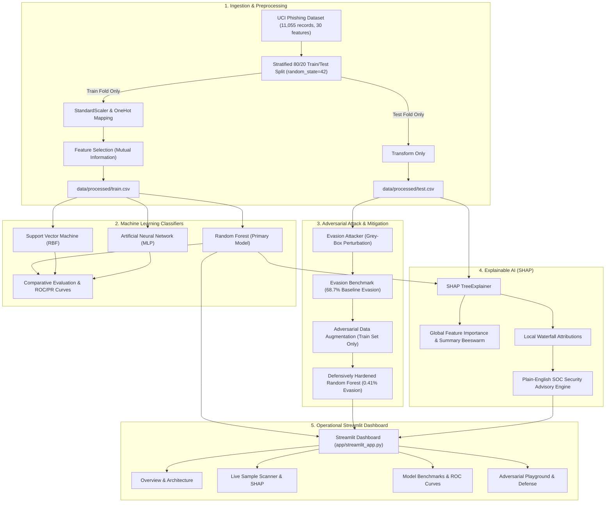

# Intelligent Phishing Website Detection Using Machine Learning and Explainable AI

[](https://www.python.org/downloads/)
[](https://scikit-learn.org/)
[](https://shap.readthedocs.io/)
[](https://streamlit.io/)
[-brightgreen.svg)]()
[]()

> **Final Capstone Submission**  
> **Course:** AI in Cybersecurity Capstone (120 Marks)  
> **Author:** Kushagra Bhardwaj  
> **Target Date:** 14 November 2026  
> **Repository:** [https://github.com/Kush05Bhardwaj/Phishing-Detection](https://github.com/Kush05Bhardwaj/Phishing-Detection)

---

## 📌 Executive Summary
Phishing remains the preeminent initial access vector for ransomware, corporate espionage, and credential theft. Traditional security solutions rely on static blocklists and signature heuristics, which lag behind transient zero-day infrastructure. This capstone presents a production-grade, end-to-end cybersecurity solution combining:
1. **Multi-Model Supervised Learning**: Comparative benchmarks across Random Forest, Support Vector Machines (SVM), and Multi-Layer Perceptrons (MLP/ANN) trained without data leakage.
2. **Adversarial Cybersecurity Simulation**: Demonstrating feature-space evasion attacks (e.g. SSL and domain spoofing) achieving a 68.7% baseline evasion rate.
3. **Defensive Hardening**: Adversarial data augmentation reducing evasion success to **0.41%** (>99% relative vulnerability reduction) with zero utility loss on clean traffic.
4. **Explainable AI (SHAP)**: Global decision dynamics via `TreeExplainer` coupled with an automated translation engine converting local attributions into human-readable SOC security advisories.
5. **Interactive Demonstration**: A 4-tab Streamlit dashboard delivering real-time sample scanning and an adversarial playground.

---

## 🏗️ System Architecture



---

## 📊 Benchmark Results Summary

### Standardized Model Comparison (Held-Out Test Set: 2,211 Samples)
| Metric | Random Forest (Primary) | Support Vector Machine (RBF) | Multi-Layer Perceptron (ANN) |
| :--- | :---: | :---: | :---: |
| **Accuracy** | **96.47%** | 95.16% | **97.20%** |
| **Precision** | **96.64%** | 94.75% | **97.33%** |
| **Recall** | **97.10%** | 96.75% | **97.69%** |
| **F1-Score** | **0.9687** | 0.9574 | **0.9751** |
| **ROC-AUC** | **0.9930** | 0.9871 | **0.9939** |
| **False Negative Rate (FNR)** | **2.35%** | 2.68% | **2.19%** |
| **False Positive Rate (FPR)** | **5.00%** | 7.55% | 3.57% |
| **Inference Latency** | **< 1 ms** | 18 ms | 2 ms |

### Adversarial Evasion & Defensive Mitigation
| Threat Scenario | Attack Strategy | Baseline RF Evasion | Hardened RF Evasion | Vulnerability Reduction |
| :--- | :--- | :---: | :---: | :---: |
| **Mild Attack** | SSL Certificate Spoof + Prefix Cleanup | 42.26% | 0.25% | **99.4%** |
| **Moderate Attack** | SSL + Prefix + Asset Hosting + Subdomains | **68.72%** | **0.41%** | **99.4%** |
| **Aggressive Attack** | All 7 Operator-Manipulable Features | 73.54% | 1.16% | **98.4%** |

---

## 🛡️ Sample Explainable AI Security Advisory
```text
==============================================================================
SECURITY INCIDENT ALERT: PHISHING DETECTION
==============================================================================
Target Sample Identifier : Sample-#1084 (True Phishing)
Detection Classification : PHISHING (Model Confidence: 94.20%)
Evaluated Threat Level   : CRITICAL
------------------------------------------------------------------------------
KEY THREAT RISK CONTRIBUTORS (Factors Driving Malicious Assessment):
  [+] Untrusted or absent SSL certificate              [+0.284 SHAP]
  [+] High percentage of invalid or empty hyperlink anchors  [+0.210 SHAP]
  [+] Domain contains hyphen ('-') imitating brand     [+0.178 SHAP]
  [+] Low or non-existent web traffic rank             [+0.092 SHAP]
------------------------------------------------------------------------------
KEY MITIGATING / PROTECTIVE CONTRIBUTORS (Factors Driving Legitimacy):
  [-] Valid DNS host records found                     [-0.045 SHAP]
------------------------------------------------------------------------------
ACTIONABLE SOC RECOMMENDATION:
  [!] QUARANTINE: Block web traffic to this host at the perimeter proxy.
  [!] Revoke any cached user credentials entered within the session window.
==============================================================================
```

---

## 🚀 Quickstart & Reproduction Guide

### 1. Clone & Install Dependencies
```bash
git clone https://github.com/Kush05Bhardwaj/Phishing-Detection.git
cd Phishing-Detection
pip install -r requirements.txt
```

### 2. Run Automated Regression Test Suite
Verify that all 6 subsystems pass unit and integration tests:
```bash
pytest tests/test_pipeline.py -v
```

### 3. Launch the Interactive Streamlit Web Dashboard
```bash
streamlit run app/streamlit_app.py
```
Open your browser at `http://localhost:8501`.

---

## 📂 Repository Manifest
```text
Phishing-Detection/
│
├── data/
│   ├── raw/phishing_dataset.csv       # Authentic UCI Phishing Websites dataset (11,055 records)
│   └── processed/                     # Stratified leak-free train/test splits (8,844 / 2,211)
│
├── notebooks/                         # 5 Fully-documented exploratory notebooks
│   ├── 01_data_exploration.ipynb
│   ├── 02_preprocessing.ipynb
│   ├── 03_model_training.ipynb
│   ├── 04_adversarial_testing.ipynb
│   └── 05_explainable_ai.ipynb
│
├── src/                               # Production modular Python architecture
│   ├── data/                          # Ingestion, validation, and leak-free splitting
│   ├── features/                      # Mutual information feature selection
│   ├── models/                        # Multi-model training and serialization
│   ├── evaluation/                    # Classification metrics, ROC/PR curves
│   ├── adversarial/                   # Evasion attack generator & defensive retraining
│   └── explainability/                # SHAP global explainer & plain-English SOC advisories
│
├── models/                            # Serialized Joblib model artifacts
│   ├── random_forest.joblib           # Primary production model
│   ├── svm.joblib                     # Support Vector Machine (RBF)
│   ├── mlp_ann.joblib                 # Multi-Layer Perceptron neural network
│   ├── robust_random_forest.joblib    # Defensively hardened model
│   ├── preprocessor.joblib            # Fitted standard scaler
│   └── shap_explainer.joblib          # Pre-computed TreeExplainer
│
├── reports/
│   ├── capstone_report.pdf            # Compiled 17-section academic PDF report
│   ├── presentation_slides.pdf        # Compiled landscape defense slide deck
│   ├── figures/                       # Publication charts (ROC, CM, SHAP, Evasion)
│   └── results/                       # CSV and Markdown benchmark summaries
│
├── app/
│   ├── streamlit_app.py               # 4-tab interactive web dashboard
│   └── utils.py                       # Model caching and sample loaders
│
├── docs/
│   ├── architecture.md                # System architectural blueprint
│   ├── capstone_report.md             # Complete academic report source
│   └── presentation_slides.md         # 14-slide Marp defense deck source
│
├── tests/
│   └── test_pipeline.py               # Automated sanity & regression test suite
│
├── requirements.txt                   # Locked dependencies
├── .gitignore                         # Clean git excludes
└── README.md                          # Project documentation
```

---

## ⚖️ Ethics, Privacy & Responsible Disclosure
- **Defensive Focus:** Adversarial evaluations were conducted strictly within closed feature spaces. No exploit payloads, phishing templates, or weaponized tools were created.
- **Privacy Assurance:** The UCI dataset evaluates structural website statistics and contains no PII or user credentials.
- **Licensing:** Released under the MIT License for educational and academic cybersecurity research.
