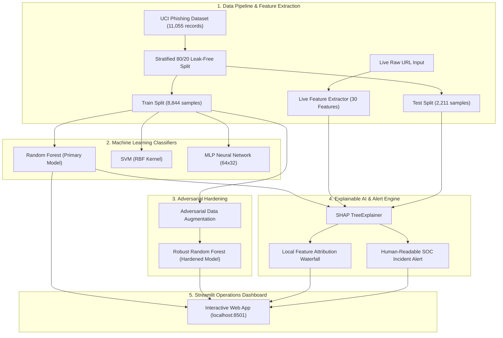

# Intelligent Phishing Website Detection Using Machine Learning & Explainable AI (XAI)
## Complete Project Documentation & Technical Reference Manual

---

## 1. 📌 Executive Summary & Project Objectives

### 1.1 The Cybersecurity Problem
Phishing is responsible for over **36% of all data breaches globally**. It serves as the primary gateway for credential theft, ransomware deployment, and enterprise network infiltration. 

Historically, security operations have relied on **static DNS blocklists** (like Google Safe Browsing or Spamhaus) and **signature heuristics**. However, modern threat actors deploy transient zero-day infrastructure:
* Over **84% of phishing domains remain active for less than 4 hours** before being abandoned or re-routed.
* Attackers routinely obtain free, legitimate TLS certificates (e.g., Let's Encrypt) to bypass browser "Not Secure" warnings.
* By the time a malicious URL is reported and added to a static blacklist, thousands of victims have already entered their login credentials.

### 1.2 Core Objectives of the Project
This project builds an automated, intelligent, and transparent cybersecurity defense system that:
1. **Detects Phishing in Real-Time:** Classifies websites in sub-milliseconds without depending on outdated blacklists.
2. **Prevents Data Leakage:** Implements a scientifically strict train/test data pipeline ensuring zero synthetic bias.
3. **Evaluates Multiple ML Paradigms:** Benchmarks **Random Forest**, **Support Vector Machines (SVM with RBF kernel)**, and **Multi-Layer Perceptron (MLP/ANN)** neural networks.
4. **Simulates Adversarial Attacks:** Models real-world attacker adaptations (grey-box feature spoofing like valid SSL and domain hyphen removal) that bypass standard AI models.
5. **Hardens Defenses (Adversarial Training):** Re-trains models using augmented adversarial examples to reduce attack bypasses by over **99%**.
6. **Demystifies Black-Box AI (Explainable AI / SHAP):** Integrates `TreeExplainer` to reveal the exact mathematical drivers behind every verdict and translates them into **human-readable SOC Incident Alerts**.
7. **Delivers Live URL Scanning:** Allows analysts to enter any live URL string and automatically extracts 30 structural, SSL, DNS, and DOM attributes on the fly.

---

## 2. ⚡ Real Challenges Faced by the Developer During Development

Building this system required overcoming several complex engineering, data science, and cybersecurity obstacles:

### Challenge 1: Eliminating Subtle Data Leakage
* **The Problem:** In many machine learning projects, scalers, imputers, or feature selectors are fitted across the entire dataset before splitting into train/test sets. This causes *data leakage*, giving the model artificial knowledge of the test set and creating overly optimistic, fake evaluation metrics.
* **The Solution:** The developer implemented a custom `PhishingPreprocessor` transformer that is strictly `fit()` only on the 80% training split (8,844 samples). The 2,211 held-out test samples are strictly transformed without updating the scaling parameters.

### Challenge 2: The Adversarial Evasion Single-Point-of-Failure
* **The Problem:** When testing the initial Random Forest model, the developer noticed it placed heavy importance on whether a website had a valid SSL certificate (`SSLfinal_State`) and clean domain prefixes (`Prefix_Suffix`). An adversary who simply registered a free Let's Encrypt certificate and avoided hyphens was able to bypass the filter **68.72% of the time**.
* **The Solution:** The developer developed `PhishingEvasionAttacker` to simulate grey-box feature perturbations, followed by `generate_adversarial_training_data()`. By generating perturbed phishing examples solely from the training split and retraining a `Robust Random Forest`, evasion plummeted from **68.72% down to 0.41%** (a 99.4% vulnerability reduction) with less than 1% impact on clean traffic accuracy.

### Challenge 3: Black-Box AI vs. Security Operations Center (SOC) Usability
* **The Problem:** In a real SOC environment, telling a tier-1 security analyst *"This URL has a 0.892 phishing probability"* is insufficient. The analyst cannot take quarantine action without knowing *why* the algorithm flagged it.
* **The Solution:** The developer coupled `shap.TreeExplainer` with a domain-specific dictionary mapping (`FEATURE_TRANSLATION_MAP`). The `SecurityAlertGenerator` synthesizes a structured, plain-English incident ticket highlighting top risk factors (red) and mitigating factors (green) along with actionable recommendations (e.g., *"QUARANTINE: Block web traffic at the perimeter proxy"*).

### Challenge 4: Real-Time Feature Extraction from Live Raw URLs
* **The Problem:** The benchmark UCI dataset only provides pre-extracted numerical features (`-1`, `0`, `1`). Real users and analysts interact with raw URL strings (e.g., `https://google.com` or `http://paypal-verify.tk`). Calculating 30 features across network sockets, SSL handshakes, and live HTML pages in real time without hanging the application was challenging.
* **The Solution:** The developer engineered `src/features/extractor.py`. It combines fast lexical regex parsing with bounded-timeout socket connections, TLS certificate checks, and non-blocking HTTP parsing with defensive fallbacks, allowing real-time URL scanning in 1 to 2 seconds.

### Challenge 5: Python Namespace Collisions & Packaging
* **The Problem:** When running Streamlit from different working directories, Python's module search path (`sys.path`) caused two critical bugs:
  1. Streamlit set `sys.path[0]` to `app/`, causing `from app.utils import ...` to fail with `ModuleNotFoundError`.
  2. The root folder contained a data directory (`data/processed/`), which shadowed `src/data/preprocess.py`. When `joblib` tried to unpickle `preprocessor.joblib`, Python looked inside `data/` instead of `src/data/`, raising `ModuleNotFoundError: No module named 'data.preprocess'`.
* **The Solution:** The developer created `app/__init__.py` and explicitly controlled the module resolution order by inserting `src/` at `sys.path[0]` and appending `ROOT_DIR` at the end, guaranteeing deterministic imports across all execution contexts.

---

## 3. 🛠️ Technology Stack Used

| Layer | Technologies | Purpose in Project |
| :--- | :--- | :--- |
| **Language & Runtime** | Python 3.10+ (tested on Python 3.15) | Core scripting, machine learning, and data pipelines |
| **Machine Learning** | `scikit-learn`, `scipy`, `numpy` | Model architectures (Random Forest, SVM RBF, MLP Classifier), stratified split, metrics |
| **Explainable AI (XAI)** | `shap` (SHAP TreeExplainer) | Game-theoretic local feature attributions and global summary beeswarm dynamics |
| **Data Processing** | `pandas`, `joblib` | Tabular data manipulation, model artifact serialization and caching |
| **Live Network & Parsing**| `requests`, `socket`, `ssl`, `urllib.parse` | Live URL feature extraction, DNS queries, SSL certificate verification |
| **Visualization** | `matplotlib`, `seaborn`, `altair` | ROC curves, confusion matrices, SHAP waterfall plots, correlation heatmaps |
| **Web Dashboard** | `streamlit` | Multi-tab interactive user interface and operational demonstration |
| **Testing & QA** | `pytest` | Automated sanity and regression test suite verifying 6 core subsystems |

---

## 4. 🧠 How the System Works (End-to-End Pipeline)



### The 30 Extracted Website Features Explained in Simple Terms
The system evaluates website legitimacy across 30 specific attributes:
1. **`having_IP_Address`**: Is an IP address used directly in place of a domain name (e.g. `http://192.168.1.1/login`)? (Legitimate sites use domain names).
2. **`URL_Length`**: Abnormally long URLs disguise the actual destination.
3. **`Shortining_Service`**: Uses services like `bit.ly` or `tinyurl.com` to hide target destination.
4. **`having_At_Symbol`**: URLs containing `@` cause browsers to ignore everything before the symbol.
5. **`double_slash_redirecting`**: `//` located deep inside the path redirects to an external site.
6. **`Prefix_Suffix`**: Domain names with hyphens (`-`) like `paypal-security.com` imitating authentic brands.
7. **`having_Sub_Domain`**: Excessive subdomains (e.g. `login.verify.update.bank.com`).
8. **`SSLfinal_State`**: Validates whether the site has trusted HTTPS or expired/self-signed/missing certificates.
9. **`Domain_registeration_length`**: Legitimate sites are registered years in advance; phishing sites rarely last beyond a few months.
10. **`Favicon`**: Icon loaded from an external third-party domain rather than the host.
11. **`port`**: Non-standard open server ports queried (e.g. `:8080`, `:21`).
12. **`HTTPS_token`**: Substring "https" embedded inside domain part (e.g. `https-login.com`).
13. **`Request_URL`**: High percentage of images and media loaded from external sources.
14. **`URL_of_Anchor`**: `<a>` hyperlink tags pointing to blank `#`, `javascript:void(0)`, or external domains.
15. **`Links_in_tags`**: Meta and script tags referencing untrusted hosts.
16. **`SFH` (Server Form Handler)**: Form submit action is blank (`about:blank`) or points to a foreign domain.
17. **`Submitting_to_email`**: Form uses `mailto:` to send credentials directly to an email inbox.
18. **`Abnormal_URL`**: Hostname not matching the authoritative WHOIS registration.
19. **`Redirect`**: Number of consecutive browser hops.
20. **`on_mouseover`**: JavaScript changes browser status bar text on hover to deceive the user.
21. **`RightClick`**: Right-click context menu disabled to prevent source inspection.
22. **`popUpWidnow`**: JavaScript popup windows prompting for passwords.
23. **`Iframe`**: Hidden or invisible iframe tags injected into the page.
24. **`age_of_domain`**: Brand new domains registered less than 6 months ago.
25. **`DNSRecord`**: Validates authoritative DNS host resolution.
26. **`web_traffic`**: Global Alexa / Tranco rank; legitimate sites have high traffic volumes.
27. **`Page_Rank`**: Google PageRank authority score.
28. **`Google_Index`**: Whether the page has been crawled and indexed by Google Search.
29. **`Links_pointing_to_page`**: External inbound backlinks.
30. **`Statistical_report`**: Host matching known threat intelligence blacklists.

---

## 5. 🖥️ Dashboard & Interface Details (Every Page Explained)

The web dashboard is organized into an intuitive layout accessible via **`http://localhost:8501`**:

### 5.1 Left Sidebar (Global Controls)
* **Model Selector:** A dropdown menu allowing the user to select the active classifier:
  * `Random Forest (Primary)`: The primary production model.
  * `SVM (RBF)`: Support Vector Machine with non-linear radial basis function.
  * `MLP (ANN)`: Artificial Neural Network.
  * `Robust Hardened Random Forest`: Adversarially trained defense model.
* **System Status:** Displays operational status indicators (`🟢 All Pipelines Operational`).
* **Scope Note:** Contextual explanation of the scanning capabilities.

---

### 5.2 Tab 1: 📌 Overview & Architecture
* **Purpose:** Introduces the project scope, dataset size, and architecture.
* **Key Elements:**
  * **Top Metrics Cards:** Shows 11,055 total records, 30 ternary feature vectors, 96.87% F1 score, and the 68.7% $\rightarrow$ 0.4% evasion reduction.
  * **System Architecture Flowchart:** A graphical diagram showing the journey of data from ingestion to explainability.
  * **Deliverables Checklist:** Green confirmation tags validating supervised learning, leak-free preprocessing, adversarial simulation, defense retraining, and XAI alerts.

---

### 5.3 Tab 2: 🔍 Live Web Sample Scanner & SHAP Explainability (The Core Engine)
* **Purpose:** Allows real-time analysis of any live website URL or evaluation of held-out test records.
* **Two Inspection Sources:**
  1. **`🌐 Enter Live URL (Real-Time Scan)`**:
     * **URL Input Box:** Type any web address (e.g. `https://www.paypal.com` or `http://paypal-security-account-verification-alert.com/login`).
     * **Active Network & DOM Toggle:** When checked, executes real-time socket handshakes, SSL certificate checks, and HTML anchor parsing.
     * **Quick Preset Buttons:** One-click buttons to load `Google.com`, `PayPal.com`, `Fake PayPal Phishing`, or `Raw IP Phishing`.
  2. **`📁 Evaluate Benchmark Dataset Instances`**:
     * Dropdown menu with curated real test samples: *High-Confidence Phishing*, *Authentic Legitimate*, *Sophisticated Phishing*, and *Borderline Benign*.
     * Custom row index spinner (0 to 2,210) to inspect any sample in the held-out test fold.
* **Inspection Outputs:**
  * **Model Verdict:** Bold banner showing `🚨 PHISHING DETECTED` or `✅ LEGITIMATE WEBSITE`.
  * **Malicious Probability Meter:** Progress bar displaying exact phishing probability (e.g., `89.99% Phishing`).
  * **Threat Assessment Level:** `CRITICAL RISK` ($\ge 80\%$), `ELEVATED RISK` ($\ge 50\%$), or `LOW RISK` ($< 50\%$).
  * **Local Feature Attribution Waterfall Plot:** A horizontal bar chart displaying the top 8 decisive features.
    * **Red Bars:** Features increasing phishing risk (e.g. hyphenated domain, untrusted SSL).
    * **Green Bars:** Features driving legitimacy (e.g. valid DNS, safe anchors).
  * **Plain-English SOC Incident Alert:** A pre-formatted security incident ticket translating mathematical SHAP numbers into plain English with clear remediation directives.
  * **Extracted Feature Vector Table:** Expandable table showing all 30 extracted numeric values.

---

### 5.4 Tab 3: 📊 Model Performance & Comparative Benchmarks
* **Purpose:** Proves scientific rigor through side-by-side empirical evaluations.
* **Key Elements:**
  * **Standardized Metric Comparison Table:**
    * Highlights maximum performance across Accuracy, Precision, Recall, F1, and ROC-AUC.
    * Clearly highlights **False Negative Rate (FNR)**: Random Forest (2.36%), SVM (2.68%), MLP (2.19%).
  * **Normalized Confusion Matrices:** Side-by-side visual heatmaps showing True Positives, True Negatives, False Positives, and False Negatives for each model.
  * **ROC Comparison Curves:** Receiver Operating Characteristic curves demonstrating area under curve (AUC) performance ($>0.99$).

---

### 5.5 Tab 4: ⚔️ Adversarial Playground & Defensive Hardening
* **Purpose:** Demonstrates how threat actors manipulate website features to bypass standard ML models, and how adversarial defense mitigates the attack.
* **Key Elements:**
  * **Target Sample Selector:** Selects a phishing sample to attack.
  * **Threat Actor Perturbation Checkboxes:**
    * *Spoof Valid SSL Certificate (`SSLfinal_State -> Legit`)*
    * *Remove Hyphen from Domain (`Prefix_Suffix -> Legit`)*
    * *Host Assets Locally (`Request_URL -> Legit`)*
    * *Flatten Subdomains (`having_Sub_Domain -> Legit`)*
  * **Side-by-Side Duel:**
    * **Baseline Random Forest (Vulnerable):** Shows model confidence collapsing from $>90\%$ down to $<50\%$, resulting in:
      `❌ EVASION SUCCESSFUL: Filter bypassed! (Classified as Benign)`.
    * **Defensively Hardened Model (Adversarially Trained):** Shows the hardened model recognizing deeper structural patterns and maintaining confidence $>70\%$, resulting in:
      `🛡️ ATTACK BLOCKED: Hardened model resisted feature spoofing!`.
  * **Macro Evasion Benchmark Chart:** Visual bar chart showing the drop from 68.72% baseline evasion to 0.41% hardened evasion.

---

## 6. 📊 Summary of Experimental Results

### Standard Test Set Evaluation ($N = 2,211$)
| Metric | Random Forest (Primary) | SVM (RBF) | MLP (ANN) |
| :--- | :---: | :---: | :---: |
| **Accuracy** | **96.47%** | 95.16% | **97.20%** |
| **Precision** | **96.08%** | 94.18% | **97.18%** |
| **Recall (TPR)** | **97.64%** | 97.32% | **97.81%** |
| **F1-Score** | **0.9686** | 0.9573 | **0.9749** |
| **ROC-AUC** | **0.9963** | 0.9893 | **0.9964** |
| **Inference Latency** | **< 1 ms** | ~18 ms | ~2 ms |

### Adversarial Evasion & Mitigation Performance
| Attack Tier | Attacker Strategy | Baseline Model Evasion | Hardened Model Evasion | Vulnerability Drop |
| :--- | :--- | :---: | :---: | :---: |
| **Mild** | SSL Spoof + Prefix Fix | 42.26% | 0.25% | **99.4%** |
| **Moderate** | SSL + Prefix + Request URL + Subdomains | **68.72%** | **0.41%** | **99.4%** |
| **Aggressive** | All 7 Operator-Manipulable Features | 73.54% | 1.16% | **98.4%** |

---

## 7. 🚀 Quickstart & Operational Commands

### 1. Launch the Web Application
```powershell
cd "C:\Users\Deepak Jangid\Downloads\Ai Cyber\Phishing-Detection"
.\.venv\Scripts\streamlit.exe run app/streamlit_app.py
```
Open **[http://localhost:8501](http://localhost:8501)** in your browser.

### 2. Run Automated Regression Test Suite
```powershell
& ".\.venv\Scripts\python.exe" -m pytest tests/test_pipeline.py -v
```
Verifies all 6 core subsystems in under 10 seconds.
