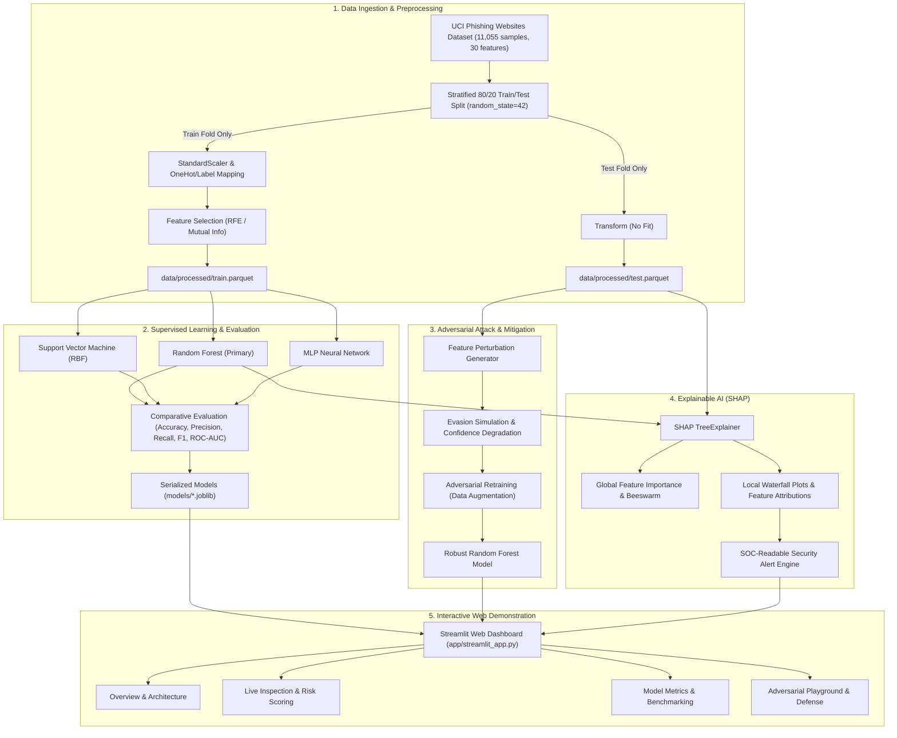

# System Architecture: Intelligent Phishing Detection & Explainable AI

This document outlines the end-to-end architecture for the Capstone Project: **Intelligent Phishing Website Detection Using Machine Learning and Explainable AI**.

